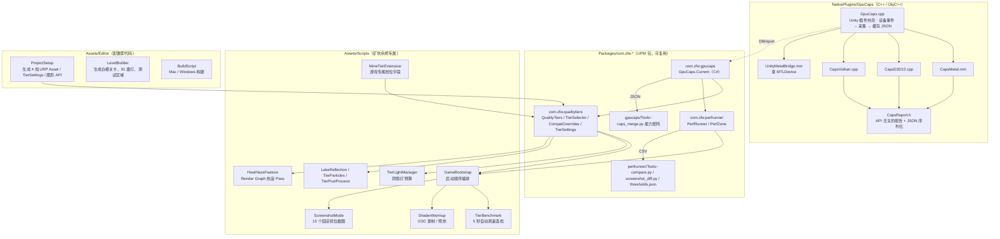
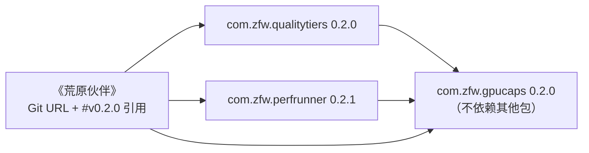
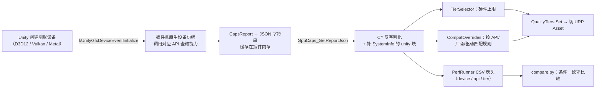
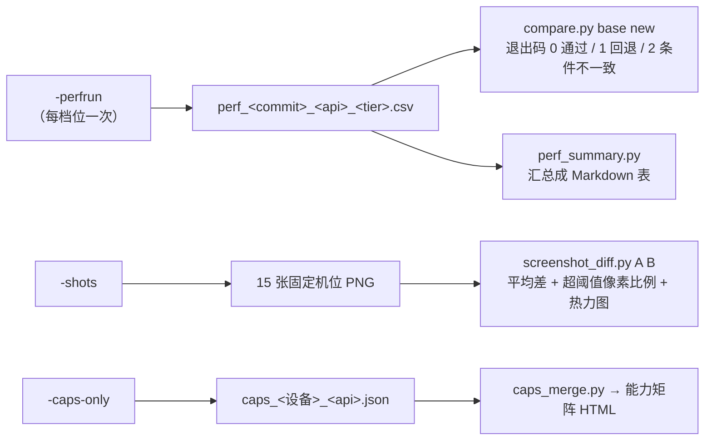

# 《矿坑余烬》01 · 架构全景

> 读法：先看"一句话"和架构图，再看"启动 + 一帧经历了什么"，最后背 3 分钟口述稿。
> 依据：`README.md`、`docs/cases/`、`docs/perf/`、`NativePlugins/GpuCaps/`、`Packages/com.zfw.*`、`Assets/Scripts/`、7 个提交（2026-11-07 ~ 11-22）。

---

## 1. 一句话

**一个约 15 分钟的 Unity 6 地下矿坑小关卡，本身只是"试验场"；真正的产物是三个可以给别的游戏复用的平台工具包：GpuCaps（探测显卡能力）、QualityTiers（按能力自动选画质档位 + 兼容回退）、PerfRunner（自动跑图采集性能 + 对比报警）。**

它要解决的问题是一个图形中台每天都在面对的事：**同一个游戏要在很多种显卡、驱动、图形 API 上跑，怎么知道每台机器能做什么、该开多高的画质、哪里变慢了、哪里画错了。**

> 类比：游戏是"一辆车"，这三个包是"4S 店的检测设备"——
> GpuCaps 是"读车辆铭牌和配置单"，QualityTiers 是"按配置推荐驾驶模式（经济/运动）"，PerfRunner 是"每次保养后上同一条试车道跑一圈、比对油耗"。

---

## 2. 术语小词典

| 术语 | 大白话 | 类比 |
| --- | --- | --- |
| Native Plugin（原生插件） | 用 C++ / Objective-C 写、编译成 .dll / .bundle，被 Unity 的 C# 调用的库 | 给 Unity 外接一个"专业仪器" |
| Unity 原生插件接口（IUnityGraphics 等） | Unity 提供给插件的一组 C 接口，能拿到 Unity 自己创建的图形设备 | Unity 把"发动机舱的钥匙"借给插件 |
| P/Invoke（`[DllImport]`） | C# 调用 C 函数的方法 | 打电话给隔壁部门 |
| 能力报告（caps report） | 一份 JSON：显卡名、显存、驱动版本、支不支持光追/VRS/Mesh Shader/Bindless | 体检报告 |
| Schema | JSON 的"格式约定"和版本号 | 表格模板 |
| 画质档位（Tier） | Low / Medium / High / Ultra 四套设置 | 汽车的驾驶模式 |
| URP Asset | Unity 通用渲染管线的一份配置（分辨率缩放、阴影、MSAA 等） | 一套出厂设置 |
| 兼容规则（compat overrides） | "某 API + 某厂商 + 某驱动范围 → 关某功能 / 限制最高档" | 召回公告："某批次车不要开某功能" |
| PSO 预热 | 提前把会用到的管线编译好，避免游戏中第一次出现某效果时卡一下 | 开店前先把常用菜的料备好 |
| GraphicsStateCollection（GSC） | Unity 6 记录"这一路用过哪些 PSO"、下次启动提前编译的接口 | 记下昨天点过的菜，今天提前备料 |
| FrameTimingManager | Unity 提供的 CPU / GPU 每帧耗时数据（有几帧延迟） | 体温计读数要等几秒才稳定 |
| 回退（regression） | 改代码后变慢了 | 保养后油耗变高 |
| Forward+ | URP 的一种渲染方式，把屏幕分块，每块只算影响它的灯，适合很多灯 | 每个区域只派附近的保安 |

---

## 3. 架构图

### 3.1 模块组成与依赖

### 3.2 三个包之间的依赖（这是"可复用"的关键）

依赖方向是单向的：GpuCaps 在最底层，谁都不依赖；另外两个只依赖它；游戏只依赖包，包不知道游戏的存在（游戏专属的档位字段通过 `TierExtension` 挂进去，见第 5 节决策 6）。

### 3.3 数据流：从显卡到报告

---

## 4. 启动和一帧经历了什么

这个项目的重点不在"一帧怎么画"（那是 URP 做的），而在**启动时怎么决定画质**和**跑图时怎么采数据**。

### 4.1 启动顺序（`Assets/Scripts/Boot/GameBootstrap.cs:21-52`）

| 步骤 | 做什么 | 代码 |
| --- | --- | --- |
| 0 | Unity 创建图形设备 → 插件收到"设备初始化"事件 → 查询能力、生成 JSON（在任何 C# 脚本之前） | `NativePlugins/GpuCaps/src/GpuCaps.cpp:74-95` |
| 1 | 读 `StreamingAssets/compat_overrides.json`，按当前 API / 厂商 / 驱动版本匹配兼容规则 | `QualityTiers.LoadCompat`，`QualityTiers.cs:114-135` |
| 2 | 如果带 `-gsc-record`，开始录制 PSO | `ShaderWarmup.cs:45-52` |
| 3 | 决定档位，优先级：命令行 `-tier=` > 存档（且 GPU 和驱动没变）> 自动跑分 | `GameBootstrap.cs:29-45` |
| 3a | 自动跑分：先按显存/是否独显算"硬件上限"，再在最重的熔炉大厅用 High 档跑 5 秒，取 GPU 平均耗时映射档位，最终取两者较低的 | `TierBenchmark.cs:21-65` |
| 4 | 加载当前 API 的全部 GSC 文件并 `WarmUp()`，提前编译 PSO | `ShaderWarmup.cs:27-42` |
| 5 | 进入模式：跑图（`-perfrun`）/ 截图（`-shots`）/ 正常游玩 | `GameBootstrap.cs:48-51` |

### 4.2 一帧（URP Forward+ 管线，加上本项目的插件点）

1. **CPU：游戏逻辑**。`TierLightManager.LateUpdate` 每隔一段时间给 91 盏火把打分（离相机近、在前方的优先），只让前 N 盏投射阴影，N 来自当前档位（`TierLightManager.cs:33-63`）。
2. **CPU：URP 组织渲染**。按当前档位的 URP Asset 决定阴影图集大小、MSAA、渲染缩放；Forward+ 把屏幕分块，统计每块受哪些灯影响。
3. **GPU：阴影**。主光阴影 + 被选中的点光源阴影（每盏 6 个立方体面）写进阴影图集。
4. **GPU：不透明物体、天空、透明物体、粒子**（粒子密度由档位决定）。
5. **GPU：热浪 Pass**。`HeatHazeFeature` 是一个 Render Graph 写法的 Renderer Feature，在后处理之前插一次全屏扭曲（`HeatHazeFeature.cs:84-95`）；兼容规则可以把它关掉。
6. **GPU：后处理**（Bloom 迭代次数、雾等由档位决定）→ 呈现。
7. **如果在跑图**：`PerfRunner` 在每帧末读 FrameTimingManager（几帧前的 CPU/GPU 耗时）、Draw Call、SetPass、显存、GC 次数，写进预分配的结构体数组（`PerfRunner.cs:108-135`），跑完一次性写 CSV。

### 4.3 离线工具链

---

## 5. 关键设计决策与取舍

| # | 决策 | 为什么 | 放弃 / 代价 | 证据 |
| --- | --- | --- | --- | --- |
| 1 | 能力探测用**原生插件**，不只用 `SystemInfo` | `SystemInfo` 回答的是"Unity 能不能用"，不是"硬件能不能做"（CASE-02：硬件支持光追，`SystemInfo.supportsRayTracing` 却是 false）；还拿不到 Bindless 层级、Mesh Shader 等 | 每个平台要单独编译插件；Windows 的 DLL 必须在 Windows 上编译（**目前还没编**） | `docs/cases/CASE-02-*.md`；`docs/windows.md` 第 1 节 |
| 2 | 插件在**设备初始化事件**里采集，C# 只读缓存 | 冷启动时插件加载可能早于设备创建，那时碰设备会崩；用 Unity 的事件回调最安全。同时兼容"插件晚加载、事件已错过"的情况 | — | `GpuCaps.cpp:1-10`、`:88-95` |
| 3 | 能力按 **"设备 × API"** 记录，不按设备 | 同一块 M5 Max，Metal 和 MoltenVK 报告的光追、VRS、Mesh Shader、显存都不同 | 能力矩阵行数变多 | `docs/cases/CASE-01-*.md` |
| 4 | 报告保留 `features`（原生）和 `unity`（SystemInfo）**两层**，每项带 `raw` 原始值 | 业务代码用 Unity 光追 API 时看 `unity` 层；评估平台能力看原生层；`raw` 方便排查"为什么判成 emulated" | JSON 更长 | `CapsReport.h:16-37`；`GpuCapsReport.cs` |
| 5 | 选档 = **min(跑分结果, 硬件上限)**，再套兼容规则上限；选档逻辑写成**不调用 Unity 的纯函数** | 只跑分会让"显存小但算力够"的卡选到 Ultra 爆显存；纯函数能写单元测试 | 首次启动多 6 秒跑分；阈值（11/14/20 ms）只在 Mac 上定过 | `TierSelector.cs:12-30`；`TierBenchmark.cs:53-56` |
| 6 | 游戏专属档位字段用 **`[SerializeReference] List<TierExtension>`** 挂进通用 TierSettings | 包里只放通用字段（灯、粒子、后处理）；多个游戏各挂自己的扩展，旧资产不用换脚本类型 | 读取时多一次类型查找 | 提交 `77c110f`；`TierSettings.cs:30-59` |
| 7 | 档位参数之间的**约束写成断言**：`灯数 × 6 × 单张² ≤ 图集²` | CASE-05：图集装不下时 URP 不报错，而是偷偷降所有阴影分辨率，High 反而比 Medium 糊 | Ultra 图集 8192² 约 128 MB | `Assets/Editor/ProjectSetup.cs:91-95`；CASE-05 |
| 8 | 兼容规则**每条必须引用一个案例编号** | 规则可追溯：为什么关、谁发现的、怎么验证的 | 写规则成本变高 | `CompatOverrides.cs:7-21`；`docs/cases/README.md` |
| 9 | PSO 预热用 GSC，**按 API × 档位分文件**，用 Development 包录制 | PSO 和 API、渲染目标格式相关；Release 包里录制是空操作（CASE-06） | 启动多约 0.9 秒；Windows 的 D3D12 / Vulkan 文件还没录 | `ShaderWarmup.cs`；CASE-06；`docs/perf/README.md` PSO 预热实验 |
| 10 | PerfRunner **每帧零分配**、丢弃启动帧、按时间戳去重 | 测量工具自己产生垃圾会触发 GC 干扰结果（CASE-08）；FrameTiming 延迟到达会重复计数（CASE-07） | 代码更复杂；拿不到新帧时该行留空 | `PerfRunner.cs:48-135` |
| 11 | `compare.py` **条件不一致就拒绝比较**（退出码 2），阈值按平台查表 | 不同 API / 设备 / 档位的数字没有可比性；M5 Max 帧时间 < 3 ms，噪声约 5%，统一 5% 阈值会误报 | 阈值要按平台维护，每条写依据 | `compare.py:29`、`:199-203`；`thresholds.json` |
| 12 | **配置即代码**：URP Asset、档位、图形 API、关卡都由编辑器脚本生成 | 可重复、可审查、改一个数重跑就行 | 手动在编辑器里改的设置会被覆盖 | `Assets/Editor/ProjectSetup.cs`、`LevelBuilder.cs` |

---

## 6. 项目现状（不要说过头）

| 项 | 状态 | 依据 |
| --- | --- | --- |
| Mac（M5 Max · Metal）上四档基线、PSO 预热实验、噪声测量 | 已完成 | `docs/perf/README.md` |
| 案例库 | 8 个（CASE-01 ~ 08），**全部在 Mac 上发现** | `docs/cases/README.md` |
| Windows（GTX 1070 Ti）D3D12 / Vulkan 能力报告、性能、截图对比、RenderDoc / Nsight 抓帧 | **未完成**（有操作手册） | `docs/windows.md`；`docs/perf/README.md` "待补" |
| Windows 版 GpuCaps.dll | **源码写好，未编译** | `docs/windows.md` 第 1 节 |
| `compat_overrides.json` | **仓库里不存在**，即目前 0 条兼容规则 | `Assets/StreamingAssets/` 只有 4 个 GSC 文件 |
| 回退拦截记录 | `docs/perf/regressions.md` **表格为空** | 该文件 |
| `docs/caps/`、`docs/captures/` | **空目录** | — |

---

## 7. 3 分钟口述稿

> 约 750 字。

《矿坑余烬》是一个十五分钟左右的 Unity 6 地下矿坑小关卡，但关卡本身只是试验场。我真正想做的是图形平台组日常需要的三件工具：**能力探测、画质分级与兼容回退、自动化性能回归**，并且把它们做成三个可以被别的项目复用的 UPM 包。我的第三个项目《荒原伙伴》就是通过 Git 地址加版本标签直接引用它们的。

**第一个包 GpuCaps**，核心是一个 C++ 原生插件。它通过 Unity 的原生插件接口拿到 Unity 自己创建的图形设备——Metal 下是 MTLDevice，D3D12 下是 ID3D12Device，Vulkan 下是物理设备句柄——然后直接问底层 API：显存多少、驱动版本、支不支持光追、VRS、Mesh Shader、Bindless。三个后端填同一个与 API 无关的报告结构，序列化成 JSON，C# 端再补上 Unity 自己的 SystemInfo。为什么不只用 SystemInfo？因为我在 M5 Max 上发现，硬件支持光追，但 Unity 的 SystemInfo 说不支持——它们回答的是两个不同的问题。另一个发现是同一块 GPU 在 Metal 和 MoltenVK 下报告的能力不一样，所以能力必须按"设备乘以 API"来记。

**第二个包 QualityTiers** 做四档画质和自动选档。选档分两步：先根据硬件事实定一个上限，比如显存小于 4G 最高只给 Medium；再在最重的场景用 High 档跑五秒，按 GPU 耗时映射档位，最后取两者较低的。选档逻辑是纯函数，有单元测试。另外有一张兼容规则表，按 API、厂商、驱动版本范围关闭某个功能或限制最高档，每条规则必须引用一个排查案例编号，保证可追溯。

**第三个包 PerfRunner** 用命令行启动游戏，相机沿固定路线飞过每个区域，逐帧记录 CPU、GPU 耗时、Draw Call、显存和 GC 次数，输出 CSV。配套的 compare.py 对比两次运行，条件不一致直接拒绝比较，阈值按平台查表；screenshot_diff.py 做固定机位截图对比。

**过程中我积累了八个排查案例**，挑两个讲：一个是档位越高阴影反而越糊——点光源阴影每盏灯要六个面，图集装不下时 URP 不报错，而是偷偷把所有阴影分辨率降低，结果 High 比 Medium 还糊。我把"灯数乘六乘单张面积小于等于图集面积"写成了断言。另一个是 PSO 预热实验第一次得出"预热反而更卡"的结论，查下去发现是测量工具的问题：FrameTimingManager 的数据晚几帧到，同一帧被记了两次，启动帧冒充成一秒卡顿。修好之后，预热消除了入口约 71 毫秒的编译卡顿，1% Low 提升约 60%。

**现状要说清楚**：所有数据都在 Mac 上，Windows 的 DLL 还没编译，1070 Ti 上的 D3D12 和 Vulkan 测试有操作手册但还没跑；兼容规则表的机制做好了，但目前还没有真实规则。下一步就是在 Windows 上把这些补齐。

---

## 8. 下一步读什么

- 原生插件怎么和 Unity 交互 → `03-关键代码导读.md` 第 1–4 段
- 排查案例怎么讲 → `04-面试问答.md` 性能排查题
