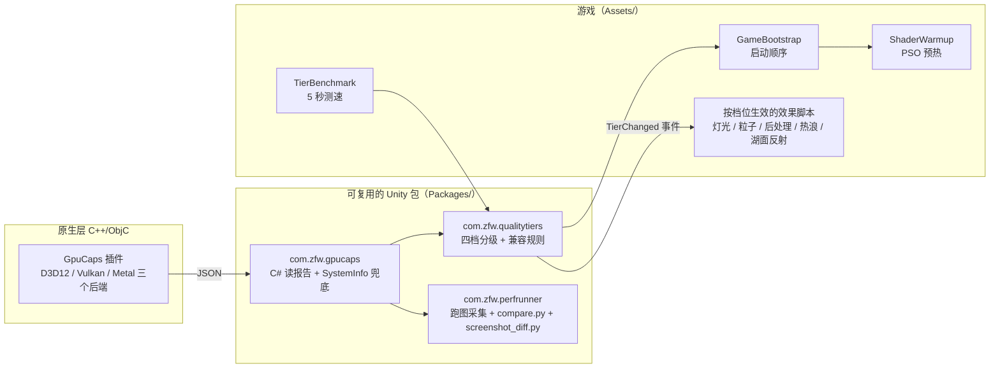
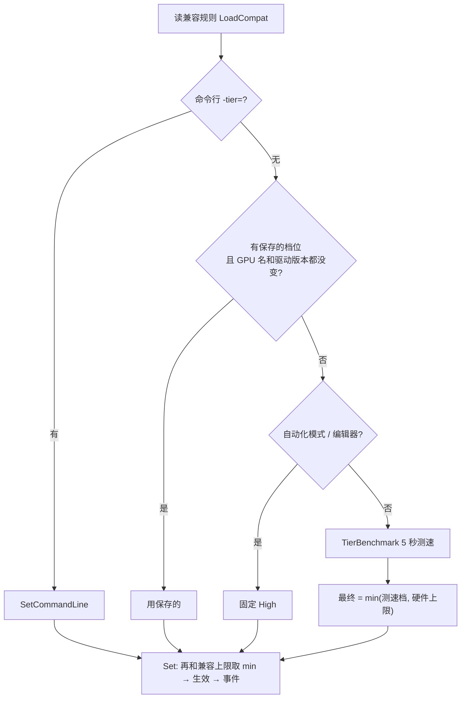

# 《矿坑余烬》02 · 模块详解

> 每个模块按同一格式讲：**职责 → 接口 → 内部流程 → 依赖谁 / 被谁依赖 → 打个比方 → 对应面试方向**。
> 三个面试方向简写为：**【兼容】**多平台能力探测、分级与回退；**【性能】**性能分析、优化与回归；**【工具】**中台工具链与流程规范。
> 和三个方向直接相关的模块（GpuCaps、QualityTiers、PerfRunner、PSO 预热）写得深，游戏侧的效果脚本写得简略。

## 总览：三个包 + 一个游戏

依赖方向是单向的：**游戏依赖包，包之间只有 `qualitytiers → gpucaps`、`perfrunner → gpucaps`，包从不依赖游戏**。游戏特有的东西通过扩展点（`TierExtension`）挂进来。这是"中台"能被第二个项目（《荒原伙伴》）复用的前提。

---

## 1. GpuCaps 原生插件（`NativePlugins/GpuCaps/`）【兼容】★

**职责**：在 Unity 创建图形设备的那一刻，直接问底层 API"这块 GPU 能做什么"，整理成一份与 API 无关的 JSON。

**为什么不直接用 Unity 的 `SystemInfo`**：`SystemInfo` 只回答"Unity 在当前配置下能不能用"，不回答"硬件能不能做"（CASE-02），而且没有 Bindless 档次、Mesh Shader、驱动原始版本号这些中台做兼容规则需要的字段。

**接口**（`src/GpuCaps.cpp:88-112`）
| 导出函数 | 谁调用 | 作用 |
| --- | --- | --- |
| `UnityPluginLoad(IUnityInterfaces*)` | Unity 加载插件时 | 拿到 `IUnityGraphics`，注册设备事件回调 |
| `UnityPluginUnload()` | Unity 卸载插件时 | 注销回调 |
| `GpuCaps_GetReportJson()` | C# P/Invoke | 返回缓存好的 JSON 字符串指针 |
| `GpuCaps_GetRendererId()` | C# P/Invoke | 诊断用：当前 API 的枚举值 |

**内部流程**
1. `UnityPluginLoad`：保存接口表，注册 `OnDeviceEvent`，然后**主动调用一次** `OnDeviceEvent(Initialize)`（`:94`）——因为插件第一次被 `[DllImport]` 触碰时设备早就建好了，不会再收到 Initialize 事件。
2. `Collect()`（`:41-72`）：`GetRenderer()` 判断当前 API → 通过对应的 `IUnityGraphicsXxx` 接口拿到原生设备句柄 → 交给对应后端：
   - **Metal**（`CapsMetal.mm:26-67`）：`MTLDevice` 的 `recommendedMaxWorkingSetSize`（统一内存下最接近"显存"的数）、GPU Family（Apple9 = M3 起才有光追硬件单元）、Argument Buffers Tier 2（Bindless）、Rasterization Rate Map（Metal 版 VRS）、Metal 3（Mesh Shader）。
   - **Vulkan**（`CapsVulkan.cpp:46-100`）：用 Unity 给的 `getInstanceProcAddr` 自己加载函数指针 → 设备属性、DEVICE_LOCAL 堆大小之和、扩展列表、`pNext` 链查询 descriptor indexing 特性。
   - **D3D12**（`CapsD3D12.cpp`）：`CheckFeatureSupport` 查资源绑定档次、光追档次、VRS 档次、Mesh Shader 档次、最高 Shader Model。Windows DLL **尚未编译**（`Plugins/Windows/` 为空），所以这条路径**没有实测过**。
3. 结果写进一个 `Report` 结构体（`CapsReport.h:21-37`），`ToJson` 手写序列化（`:60-79`），在互斥锁保护下缓存成字符串。
4. 设备销毁事件（`:77-81`）清空缓存。

**依赖**：Unity 原生插件头文件（`IUnityGraphics.h` 等）、各平台 SDK。**被依赖**：`com.zfw.gpucaps` 的 C# 层。

**打个比方**：GpuCaps 是"体检医生"——不靠病人自己说"我身体不错"（SystemInfo），而是直接拿仪器量。量出来的结果写成统一格式的体检表，谁来看都能读懂。

**设计要点**
- 每个后端一个文件，只编译当前平台的那个（`CMakeLists.txt`）。
- Metal 的头文件里有 Objective-C 类型，只能在 `.mm` 里包含 → 专门一个 `UnityMetalBridge.mm`（`:9-15`）把 `id<MTLDevice>` 转成 `void*` 交出来；还按 V2 → V1 → 无版本号的顺序回退，兼容旧版播放器。
- 每个特性同时记 `value`（supported / unsupported / emulated）和 `raw`（原生档次名），矩阵里鼠标悬停能看到依据。
- `schema` 版本号（`CapsReport.h:13`）：以后加字段时，合并工具 `caps_merge.py` 能识别旧报告。

---

## 2. com.zfw.gpucaps（C# 层）【兼容】

**职责**：把原生 JSON 读进 C#，补上 Unity 自己的视角（`SystemInfo`），对外提供 `GpuCaps.Current`；插件不可用时退化成只用 `SystemInfo`。

**接口**
- `GpuCaps.Current`（懒加载 + 缓存，`GpuCaps.cs:24`）、`Refresh()`、`Write(report, dir)`、`ShortDeviceName()`。
- 命令行（`GpuCapsBootstrap.cs`）：`-caps-out <dir>` 写报告，`-caps-only` 写完立即退出——用于在测试机上批量采集。

**内部流程**（`GpuCaps.cs:29-54`）
1. P/Invoke 调用 `GpuCaps_GetReportJson()` → `Marshal.PtrToStringUTF8` **立即复制**（原生指针下次设备事件后失效）→ `JsonUtility.FromJson`。
2. 找不到 DLL / 入口时只捕获这两种异常，记警告，不崩溃。
3. 没有原生结果或 API 不在支持范围（D3D11、OpenGL、编辑器里的某些情况）→ `FromSystemInfo`（`:56-74`），`source = "systeminfo"`，原生拿不到的字段明确写 "unknown (no native plugin)"。
4. `FillUnity`（`:76-87`）无论哪种来源都补一份 `unity` 块。

**报告结构**（`GpuCapsReport.cs`）：`schema / api / gpu{name, vendorId, dedicatedMemoryMB} / driver{version, raw} / os / features{bindless, raytracing, vrs, meshShader, shaderModel} / unity{...} / source / error`。

**工具**：`Tools~/caps_merge.py` 把多份 `caps_<设备>_<API>.json` 合并成 HTML 矩阵，**各列取值不同的行高亮**（CASE-01 就是这样看出来的）。

**打个比方**：原生插件是体检仪器，这一层是"前台"——把仪器打印的报告装进档案袋，仪器坏了就让病人自己填一张简表，并在档案上注明"这份是自填的"（`source` 字段）。

**测试**：`Tests/Editor/GpuCapsTests.cs`（EditMode），检查报告字段齐全——CASE-02 就是在这里发现的。

---

## 3. com.zfw.qualitytiers【兼容】【性能】★

**职责**：决定当前用哪一档（Low / Medium / High / Ultra），把档位的参数生效，并在切档时通知所有关心的人。是全项目"画质设置的唯一真相来源"（`QualityTiers.cs:9-12` 注释）。

### 3.1 数据：档位表

- `Tier` 枚举（`Tier.cs:4`）：**数值越小越便宜**，所以"取两个限制里更保守的"就是 `min`（`TierSelector.Min`）。
- `TierCatalog`（ScriptableObject）：四个 `TierSettings` 的引用，放在 `Resources/` 下。
- `TierSettings`（`TierSettings.cs:9-51`）：通用旋钮——对应的 URP Asset、投影点光数量、阴影分辨率、粒子密度、软粒子、Bloom 及迭代次数、雾。
- **扩展点**：`[SerializeReference] List<TierExtension> extensions`（`:32`）。包只认识通用旋钮；游戏自己继承 `TierExtension`（本项目是 `MineTierExtension`：热浪、湖面反射），通过 `Get<T>()` 取用。`SerializeReference` 让 Unity 能序列化"基类引用指向子类对象"的多态列表。

### 3.2 决策：怎么选档

启动顺序在 `GameBootstrap.Start`（`GameBootstrap.cs:21-52`）：

- **硬件上限**（`TierSelector.CapFromHardware`，`:16-21`）：非独显 → Low；显存 < 4096 MB → Medium；否则 Ultra。Apple Silicon 按"类独显"处理（`IsDiscreteLike`，`:38-47`），理由写在注释里：统一内存带宽和独显同级。
- **测速**（`TierBenchmark.cs:21-65`）：先切到 High，镜头沿最重的熔炉区路径飞 1 秒预热 + 5 秒采集，取 FrameTimingManager 的 GPU 平均时间；GPU 时间拿不到就退回 CPU 时间。
- **阈值**（`TierSelector.cs:12`）：≤ 11 ms → Ultra；≤ 14 → High；≤ 20 → Medium；否则 Low；没有任何计时 → Medium（"安全中间值"）。
  - ⚠️ 这几个阈值的来源注释是"在熔炉厅以 High 测得"，但 M5 Max 上 High 只有约 2 ms，**阈值并没有在目标机 GTX 1070 Ti 上标定过**——待确认。
- **重新选档条件**（`NeedsReselect`，`:52-53`）：GPU 名或驱动版本变了，保存的结果作废。
- **三种模式**（`SelectionMode`）：Auto / Manual / CommandLine。玩家手动选的会保存并优先（`Set` 里 `if (manual) Save()`）。

### 3.3 回退：兼容规则

`CompatOverrides.cs` + `QualityTiers.LoadCompat`（`QualityTiers.cs:114-135`）：
- 规则字段：`api`、`vendor`、`driverMin / driverMax`（闭区间、逐段数字比较，`CompareVersion` `:56-66`）、`disable[]`（关掉的特性名）、`maxTier`（档位上限）、`case`（**必须引用一个案例编号**）。
- 所有命中的规则：`disable` 合并；`maxTier` 取最小；案例编号记进 `AppliedCases` 方便设置界面和日志显示。
- 业务代码用 `QualityTiers.IsDisabled("HeatHaze")` 查询。
- ⚠️ **现状**：机制完整、有单元测试，但 `StreamingAssets/compat_overrides.json` **不存在，规则数为 0**——因为目前只在 Mac 上测过，没有遇到需要回退的设备问题。

### 3.4 生效

`Set`（`:44-54`）→ `Apply`（`:96-107`）只做一件事：`QualitySettings.renderPipeline = 对应 URP Asset`（MSAA、渲染缩放、阴影图集尺寸都在 URP Asset 里）→ 触发 `TierChanged` 事件。其他效果由各自的脚本监听事件后自己调整（见第 6 节）。

**依赖**：`com.zfw.gpucaps`。**被依赖**：游戏的启动脚本和所有档位相关脚本。

**打个比方**：QualityTiers 是"餐厅的套餐系统"。四个套餐（档位）写在菜单上（TierCatalog）；客人进门先看他的预算（硬件上限）、再让他试吃 5 秒（测速），推荐两者里更便宜的那个；后厨有一张"过敏清单"（兼容规则），某类客人不能上某道菜，每条都要写明是哪次事故后加的（案例编号）。每家分店（每个游戏）可以在套餐上加自己的特色菜（`TierExtension`），不用改总部的菜单格式。

**测试**：`Tests/Editor/TierSelectorTests.cs`（阈值、上限、版本比较、重选条件）、`TierExtensionTests.cs`（扩展点）。

---

## 4. com.zfw.perfrunner【性能】【工具】★

**职责**：自动跑图采集逐帧性能数据（运行时），离线比较两次运行判断有没有回退（`compare.py`），比较固定机位截图判断画面有没有变化（`screenshot_diff.py`）。

### 4.1 运行时采集（`Runtime/PerfRunner.cs`、`PerfZone.cs`）

**接口**：命令行 `-perfrun [-perf-out dir] [-perf-seconds 20] [-perf-warmup 3]`；事件 `Started`（游戏关掉输入）、`Finished(csvPath)`。

**流程**（`PerfRunner.cs:57-141`）
1. 关 VSync、不限帧率（`:60-61`）——测的是 GPU 能跑多快，不是显示器刷新率。
2. 开三个 `ProfilerRecorder`：Draw Calls、SetPass Calls、Gfx Used Memory（`:63-65`）。
3. 找到所有 `PerfZone`（每个区域 = 一串路径点，按 `order` 排序），接管主相机（关掉 Cinemachine Brain 之类，`:143-149`）。
4. **按容量预分配**样本列表（`:80-81`），采集期间几乎不扩容。
5. **丢弃启动帧**：`max(maxQueuedFrames, 2) + 4` 帧（`:89-94`），原因见 CASE-07。
6. 每个区域：先在起点停 `warmupSeconds`（让流式加载、着色器编译、粒子起转稳定下来），再沿路径匀速插值采 `secondsPerZone` 秒，每帧一行。
7. 每帧只往 `List<Sample>`（结构体）里写原始数字；**用 `frameStartTimestamp` 去重**（`:118`）；没有新完成帧就留空（`NaN`）。
8. 全部结束后一次性格式化 CSV（`:153-165`），文件头写 commit、API、设备、档位、Unity 版本、日期（`:180-185`）。

**CSV**：`frame,zone,cpu_ms,gpu_ms,draw_calls,setpass_calls,gfx_mem_mb,gc`

### 4.2 回退检测（`Tools~/compare.py`）

- **可比性检查**（`:199-203`）：两份 CSV 的 `api / device / tier` 任何一个不同 → 拒绝比较，退出码 2。
- **阈值**（`resolve_threshold`，`:170-181`）：从 `thresholds.json` 按设备/API/档位子串匹配第一条规则；当前只有一条：Apple → 8%（依据：M5 Max 上两次相同运行湖区差了 4.9%），其他默认 5%。命令行 `--threshold` 优先。
- **判定**（`:211-219`）：逐区域比较 **GPU 平均时间**的相对变化，任何一个区域超阈值 → 退出码 1。
- 同时输出 p95、CPU 平均、1% Low、Draw Call，和一张 SVG 帧时间曲线的 HTML 报告。
- 只用标准库，方便在没装 pip 的 Windows 测试机上跑。

### 4.3 画面回归（`Tools~/screenshot_diff.py`）

- 对两个目录里同名 PNG：每像素取三通道差的最大值，超过 `--pixel-threshold`（默认 16/255）算"变了"；变了的像素比例超过 `--fail-ratio`（默认 1%）→ 退出码 1，提示人工复查。
- 输出热力图（黑 → 红 → 黄 → 白）。
- 自带一个最小 PNG 解码器（`:27-89`，支持 PNG 的 5 种行过滤），不依赖 Pillow。
- 配套的游戏侧 `ScreenshotMode`（`-shots <dir>`）：固定粒子随机种子和模拟时间、冻结火把闪烁和热浪时间，保证同一机位两次截图逐像素可比。

**依赖**：`com.zfw.gpucaps`（文件头的设备名）。**被依赖**：`TierBenchmark`（复用 `PerfZone` 路径）、`tools/run_mac_suite.sh`、`tools/perf_summary.py`（导入 `compare.py` 的解析函数做多条件汇总）。

**打个比方**：PerfRunner 是"标准化路考"——每次都开同一条路线、同样的车速，行车记录仪逐帧记录；`compare.py` 是"考官"，只比同一辆车、同一条路的两次成绩，差距超过误差范围就判不合格；`screenshot_diff.py` 是"找不同"游戏。

**现状**：工具在 Mac 上跑通、有测试（`tools/test_tools.py`）；`docs/perf/regressions.md` **是空的**——还没有真正拦截过一次回退。

---

## 5. PSO 预热（`Assets/Scripts/Boot/ShaderWarmup.cs`）【性能】★

**职责**：消除"第一次看到某个效果时卡一下"。

**原理**：D3D12 / Vulkan / Metal 第一次用到"着色器 + 混合 + 顶点格式 + 渲染目标格式"这一整套组合时，驱动要把它编译成 GPU 机器码（PSO），可能花几十到几百毫秒。Unity 6 的 `GraphicsStateCollection`（GSC）能**记录**一次运行里实际用到的所有组合，下次在加载画面**提前编译**。

**流程**
- 录制（`:45-61`）：`-gsc-record` → `BeginTrace()`；PerfRunner 跑完 → `EndTrace()` + `SaveToFile()`，打印状态数和变体数。
- 预热（`:27-42`）：启动时加载 `StreamingAssets/gsc_<当前API>_*.graphicsstate`（**每个档位一份**，因为不同档位的 URP Asset 打开的 MSAA、深度纹理不同，PSO 也不同），`WarmUp().Complete()`。

**实测**（`docs/perf/README.md`，M5 Max，冷着色器缓存，各 3 次）：入口首段峰值 71.5 ms → 约 3.7 ms；入口 1% Low 约 +60%；代价是启动多 914–922 ms（128 个状态）。

**两个坑**：CASE-06（Release 包录不到）、CASE-07（测量工具把启动帧算成了卡顿）。

**打个比方**：PSO 编译像"第一次做一道菜要先查菜谱"。GSC 是把今天客人点过的菜记下来，明天开门前先把这些菜谱都背熟。

**依赖**：Unity 的 `UnityEngine.Experimental.Rendering`。**被依赖**：`GameBootstrap`。

---

## 6. 按档位生效的效果脚本（`Assets/Scripts/Rendering/`）【性能】

都遵循同一个模式：`OnEnable` 订阅 `QualityTiers.TierChanged`，立即按当前档位应用一次，`OnDisable` 取消订阅。

| 脚本 | 做什么 | 要点 |
| --- | --- | --- |
| `TierLightManager` | 每 0.25 秒给所有火把打分（距离近、在镜头前方、优先级高者得分高），只让前 N 盏投射阴影（N 来自档位） | 点光源阴影每盏 6 个立方体面，是 GPU 开销最大的旋钮；排序用缓存的比较器避免每次分配（CASE-08） |
| `TierParticles` | 按档位缩放粒子发射率和上限；切换软粒子关键字 | Low 的 URP Asset 不生成深度纹理，软粒子必须关；材质按"(原材质, 软/硬)"复用一份运行时副本，不破坏 SRP Batcher 合批 |
| `TierPostProcess` | Low 只色调映射；Medium 加少量 Bloom；High 加雾；Ultra 全开 | 改的是 Volume 的运行时副本，磁盘上的资源不变 |
| `HeatHazeFeature` | 熔炉区热浪扭曲，用 **Render Graph** API 写的 Renderer Feature | 声明"读相机颜色、写扭曲后的副本、把副本设成新的相机颜色"，省一次拷回；需要 Opaque Texture |
| `LakeReflection` | 湖面实时反射探针：Ultra 每 4 帧分时刷新一个面，其他档位只在启动和切档时渲染一次 | CASE-04：质量设置里的总开关关着时，脚本调用会被静默忽略 |
| `Assets/Editor/ProjectSetup.cs` | 编辑器菜单：生成四个 URP Asset、TierSettings、场景 | `:91-95` 用断言保证"灯数 × 6 × 单张² ≤ 图集²"（CASE-05） |

**打个比方**：QualityTiers 广播"今天改吃套餐 B"，各个灶台（脚本）自己知道套餐 B 对自己意味着什么。总部不需要知道每个灶台的细节。

---

## 7. 工具脚本（`tools/`）【工具】

| 脚本 | 作用 |
| --- | --- |
| `unity.sh` | 命令行调用 Unity 执行方法；非编译错误失败时自动重试一次（CASE-03），编译错误不重试 |
| `run_mac_suite.sh` | 一键：无 GSC 构建 → 冷缓存跑 3 次 → 有 GSC 构建 → 冷缓存跑 3 次 → 四档各跑一次 |
| `perf_summary.py` | 和 `compare.py` 相反：**故意**混合不同档位/API/设备，汇总成一张对比表；多了"入区峰值"（进入区域后前 120 帧的最差帧，看 PSO 卡顿用） |
| `contact_sheet.py` | 把一组截图拼成一张缩略图总览 |
| `test_tools.py` + `testdata/` | Python 工具的单元测试 |

---

## 8. 文档体系（`docs/`）【工具】

| 位置 | 内容 | 现状 |
| --- | --- | --- |
| `docs/cases/` | 平台差异案例库，固定模板（平台/现象/复现/定位/根因/修复/验证/教训） | 8 个，全部在 Mac 上发现 |
| `docs/perf/README.md` | 四档基线、PSO 预热实验、噪声与阈值依据、CSV 格式 | Mac 第一轮完整；Windows 待补 |
| `docs/perf/regressions.md` | 回归记录 | **空** |
| `docs/caps/`、`docs/captures/` | 能力报告、抓帧截图 | **空** |
| `docs/windows.md` | Windows 测试机操作手册 | 写好，未执行 |

**面试要点**：案例库模板里"每条兼容规则必须引用一个案例编号"——这是让规则可追溯、可删除的关键。没有出处的回退规则会越积越多，最后谁也不敢删。
